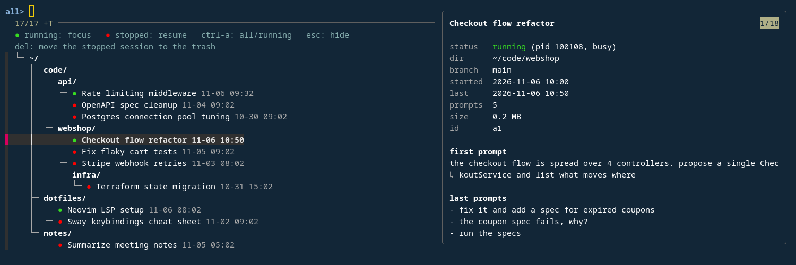

# claude_sessions

A session picker for [Claude Code](https://claude.com/claude-code): your Claude sessions as a tree of their working directories, in any terminal, and on [sway](https://swaywm.org) one hotkey away.

- **green ●** running: Enter focuses its terminal window (sway)
- **red ●** stopped: Enter resumes it (`claude --resume`) in its directory



It starts with the running sessions; ctrl-a shows all. The details pane on the right shows the selected session's status, terminal, directory, git branch, start, last activity, prompt count, size, ID, and first and last prompts.

| key | |
|---|---|
| Enter | focus / resume the session |
| typing | filter |
| ctrl-a | show all / only running sessions |
| Delete | move a stopped session to the trash (`gio trash`) |
| Esc | quit (sway window: hide) |

## Two ways to run it

**In any terminal:** `claude-sessions`. Enter on a stopped session ends the picker and resumes the session in the same terminal. Enter on a running session focuses its window under sway; elsewhere it does nothing (the details pane shows the session's terminal).

**As a sway window:** `claude-sessions --toggle` shows the picker in a floating window from the sway scratchpad. It keeps running while hidden, so the cursor, the filter and the mode survive between uses; each time it's shown, the list is refreshed. Enter hides it and focuses the running session, or resumes the stopped one in a new terminal window. ctrl-c quits it for good; the next `--toggle` starts a new one.

What needs sway: the window mode and focusing a running session. Listing, details, resuming in the same terminal and deleting don't.

## Requirements

- Python 3, fzf 0.71 or newer (tested with 0.74), `gio` (glib2), `notify-send` (optional)
- window mode: sway, curl, and Alacritty or foot
- for the test: tmux, jq; sway, Alacritty and foot for the window mode tests

On Fedora:

```sh
sudo dnf install fzf glib2 libnotify curl alacritty
```

On Ubuntu:

```sh
sudo apt install libglib2.0-bin libnotify-bin curl alacritty
```

Ubuntu's fzf is too old (24.04: 0.44, 26.04: 0.67), so install fzf from its [releases](https://github.com/junegunn/fzf/releases), e.g.:

```sh
mkdir -p ~/.local/bin
curl -L https://github.com/junegunn/fzf/releases/download/v0.74.5/fzf-0.74.5-linux_amd64.tar.gz | tar -xz -C ~/.local/bin
```

## Install

```sh
make install            # into ~/.local/bin
make install PREFIX=/usr/local
make uninstall
```

## sway config

```
bindsym $mod+c exec ~/.local/bin/claude-sessions --toggle
for_window [app_id="^claude-sessions$"] floating enable, move scratchpad
exec ~/.local/bin/claude-sessions --start
```

`--start` starts the hidden picker at login. `--toggle` shows it on the current workspace (70% × 70%, centered), or hides it when it's focused; it also starts the picker if it isn't running. Use absolute paths: sway's `PATH` usually lacks `~/.local/bin`.

The window mode uses Alacritty. For foot, set `CLAUDE_SESSIONS_TERMINAL=foot` in the environment sway starts it with:

```
bindsym $mod+c exec env CLAUDE_SESSIONS_TERMINAL=foot ~/.local/bin/claude-sessions --toggle
exec env CLAUDE_SESSIONS_TERMINAL=foot ~/.local/bin/claude-sessions --start
```

## Colors (Alacritty)

If `~/.config/alacritty/claude-sessions.toml` exists, the picker window uses it instead of your normal Alacritty config. To keep your config and change only the colors, import both, e.g. with [Cobalt2](https://github.com/alacritty/alacritty-theme/blob/master/themes/Cobalt2.toml) from alacritty-theme (as in the screenshot):

```toml
[general]
import = ["~/.config/alacritty/alacritty.toml", "~/.config/alacritty/themes/Cobalt2.toml"]
```

## How it works

- **Sessions:** the transcripts in `~/.claude/projects/*/<session-id>.jsonl` (or `$CLAUDE_CONFIG_DIR`). The working directory comes from the first record that has one, the title from the last AI-generated title (`ai-title` record), else the last prompt. Headless runs (`claude -p`) are left out.
- **Running:** `~/.claude/sessions/<pid>.json`, if the pid is alive and its start time matches (so a reused pid doesn't count).
- **Focus:** walks up the parent processes of the `claude` process to the first one that owns a sway window.
- **Resume:** in the same terminal, fzf's `become` runs `claude --resume <id>` in the session's directory. In the window mode, a new terminal runs `$SHELL -ic 'claude --resume <id>; exec $SHELL'`; the interactive shell loads your `PATH` from `.bashrc`. Either way, `CLAUDE*` variables (except `CLAUDE_CONFIG_DIR`) are removed, so the picker can be started from inside a Claude session without making the resumed one its child.
- **Refresh** (window mode): fzf listens on `$XDG_RUNTIME_DIR/claude-sessions.sock`; `--toggle` sends it a reload. `--track --id-nth=1` keeps the cursor on the same session.
- **Delete:** moves the transcript, the session's subagent directory, `file-history/<id>` and `session-env/<id>` to the trash. Running sessions are skipped.

These are Claude Code's internal files, not a public interface (tested with Claude Code 2.1.319). A new version may change them.

## Test

```sh
make test
```

`test.sh` builds a fake Claude directory in a temporary `HOME` (stopped sessions, a "running" one backed by a `sleep` process, a headless one) with stubs for `claude` and `notify-send`, and:

- drives the picker in a detached tmux session: listing, details pane, Tab (ignored), Enter, ctrl-a, Delete
- runs the window mode in a headless nested sway, once with Alacritty and once with foot: `--start`, `--toggle`, focusing a running session's window, resuming a stopped one in a new window

It doesn't touch your sway session, your Claude sessions or your trash.

## Limits

- **Focus** needs `claude` to run directly in a terminal window. Inside tmux or screen its ancestor is the multiplexer's server, not a window, so it isn't found.
- **Several windows of one terminal process** (e.g. `alacritty msg create-window`, `foot --server`): the first window of that process is focused.

## License

[WTFPL](http://www.wtfpl.net/), see `LICENSE`.
